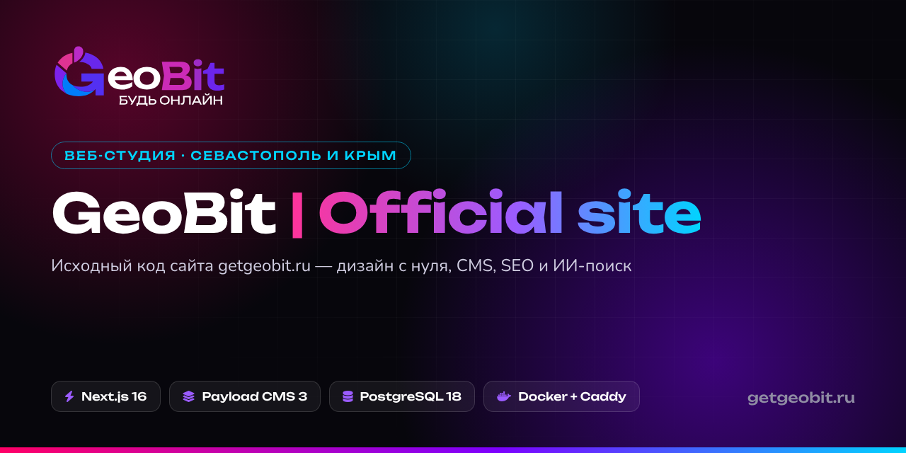
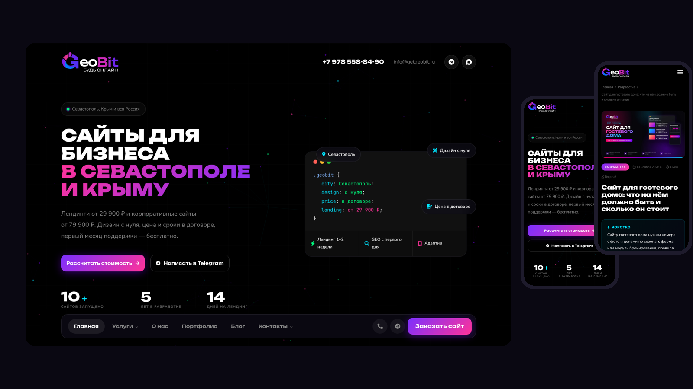
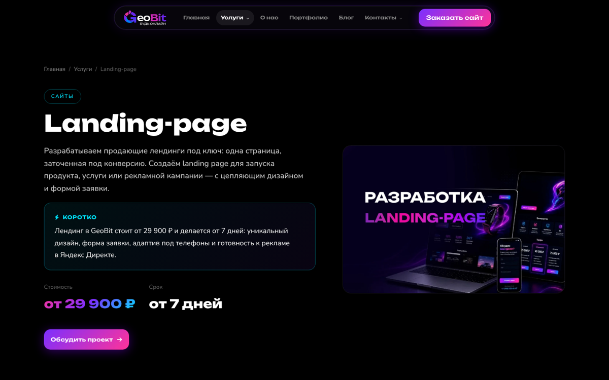
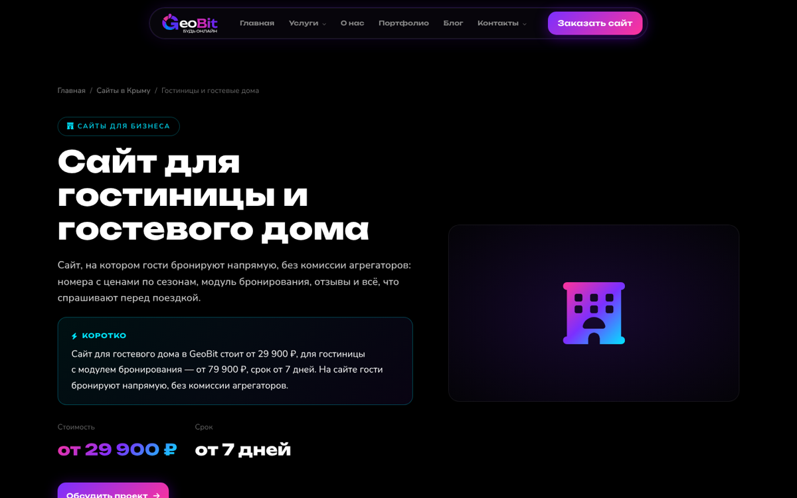
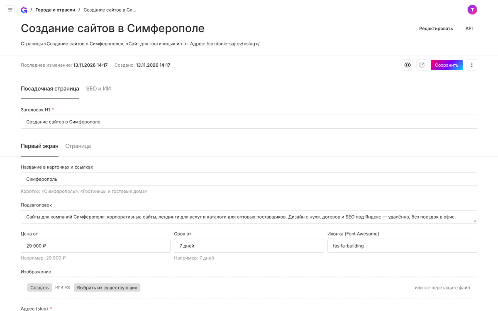
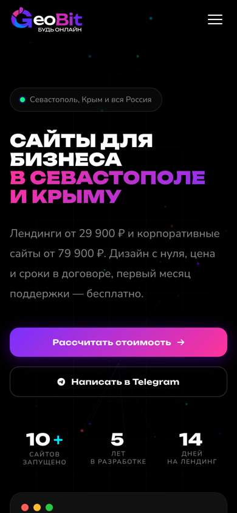
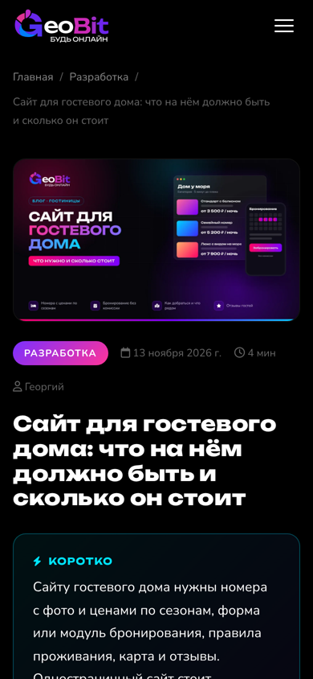
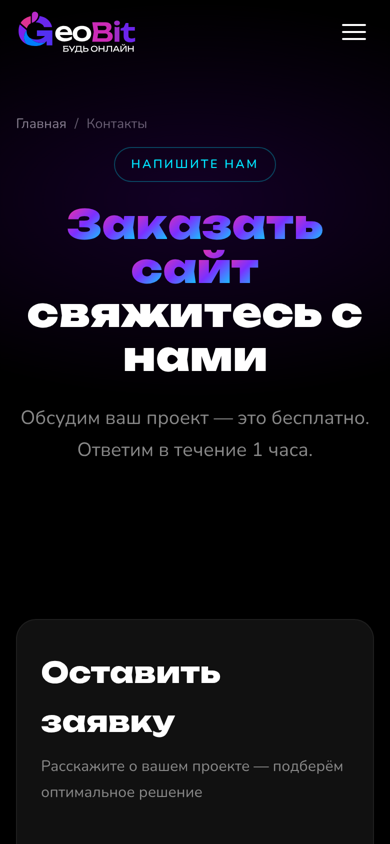
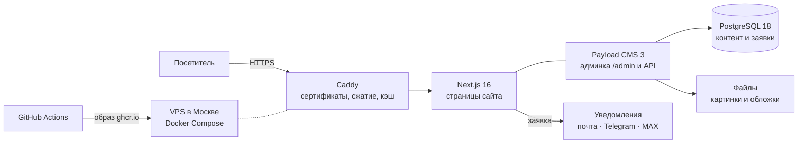

<p align="center">
  <a href="https://getgeobit.ru"></a>
</p>

<p align="center">
  <a href="https://getgeobit.ru"></a>
  
  
  
  
  
</p>

<p align="center">
  <b>Сайт веб-студии GeoBit</b> — разработка сайтов, дизайн и SEO для бизнеса в Севастополе, Крыму и по всей России.<br>
  Лендинги от 29 900 ₽ · корпоративные сайты от 79 900 ₽ · интернет-магазины от 129 900 ₽
</p>

<p align="center">
  <a href="https://getgeobit.ru"><b>Открыть сайт</b></a> ·
  <a href="https://getgeobit.ru/portfolio/">Портфолио</a> ·
  <a href="https://getgeobit.ru/services/">Услуги</a> ·
  <a href="https://getgeobit.ru/blog/">Блог</a> ·
  <a href="https://getgeobit.ru/contacts/">Связаться</a>
</p>

---



## О проекте

Это исходный код официального сайта студии GeoBit. Сайт сделан с нуля: свой дизайн в тёмной теме, админка для всего контента, продуманное SEO и защита персональных данных по 152-ФЗ. Работает на собственном сервере в России.

Сайт — одновременно и витрина студии, и пример того, как мы делаем проекты для клиентов.

## Что внутри

| | |
|---|---|
| 🎨 **Дизайн с нуля** | Тёмная тема, фирменная палитра, шрифт Unbounded, анимации, отдельно проработанные телефоны и планшеты |
| 🧩 **Удобная админка** | Payload CMS на русском: услуги и цены, кейсы, статьи, страницы, калькулятор, меню, заявки — всё правится без программиста |
| 📈 **SEO под Яндекс** | Мета-теги и микроразметка (Organization, Service, FAQ, BreadcrumbList, BlogPosting), карта сайта, IndexNow, SEO-аудит прямо в админке |
| 🤖 **Готовность к ИИ-поиску** | Короткие ответы для Алисы и ИИ-ассистентов, `llms.txt`, настройка доступа ИИ-ботов в `robots.txt` |
| 🗺️ **Города и отрасли** | Посадочные страницы для Симферополя, Ялты, Евпатории, Феодосии, Керчи и для отраслей: гостиницы, кафе, экскурсии, автосервисы |
| 🖼️ **Картинки для соцсетей** | Фирменная карточка для каждой страницы генерируется автоматически (`/og/`) |
| 🗓️ **Публикация по расписанию** | Статьи блога выходят сами в заданное время |
| 📬 **Заявки** | Формы с защитой от спама, письмо на почту, уведомление в Telegram и MAX, подтверждение клиенту, цели в Яндекс Метрике |
| 🔒 **Безопасность** | Лимиты попыток входа и форм, CSRF-защита, заголовки безопасности, загруженные файлы не исполняют скрипты |
| ⚖️ **152-ФЗ** | Согласие отдельным документом, баннер cookie с выбором категорий, данные только на серверах в России, журнал согласий, автоудаление старых заявок |

## Скриншоты

<table>
  <tr>
    <td width="50%"><p align="center"><sub>Страница услуги с интерактивным макетом</sub></p></td>
    <td width="50%"><p align="center"><sub>Посадочная страница «Сайт для гостиницы»</sub></p></td>
  </tr>
  <tr>
    <td width="50%"><p align="center"><sub>Админка: всё на русском, с подсказками</sub></p></td>
    <td width="50%">
      <p align="center">
        
        
        
      </p>
      <p align="center"><sub>Мобильная версия</sub></p>
    </td>
  </tr>
</table>

## Как устроено



- **Фронтенд и бэкенд в одном приложении.** Next.js рендерит страницы на сервере, Payload работает внутри него же: одна сборка, один контейнер.
- **Контент только в базе.** Тексты, цены и картинки меняются в админке и сразу появляются на сайте, без пересборки.
- **Деплой по пушу.** Пуш в `main` → GitHub Actions собирает Docker-образ → сервер скачивает его и перезапускается. Миграции базы применяются сами при старте.

## Стек

| Слой | Технологии |
|---|---|
| Приложение | Next.js 16 (App Router, standalone), React 19, TypeScript |
| CMS | Payload CMS 3: коллекции, глобалы, версии и черновики, очередь задач, Lexical-редактор |
| База | PostgreSQL 18, миграции Payload |
| Картинки | sharp (webp, нарезка размеров), `next/og` для карточек соцсетей |
| Почта | Nodemailer, свои шаблоны писем со светлой и тёмной темой |
| Сервер | Ubuntu 24.04, Docker Compose, Caddy (HTTPS от Let's Encrypt), резервные копии базы по расписанию |
| CI/CD | GitHub Actions → GitHub Container Registry → VPS |

## Структура

```
src/
├── app/(frontend)/     страницы сайта: главная, услуги, кейсы, блог, города и отрасли
├── app/(payload)/      админка Payload
├── app/ajax/           приём форм (заявки, подписка)
├── app/og/             генерация картинок для соцсетей
├── collections/        что редактируется в админке: услуги, кейсы, статьи, заявки…
├── globals/            страницы-одиночки и настройки сайта
├── components/         шапка, подвал, секции страниц, панели админки
├── content/            тексты, которые заливаются миграциями (статьи, документы)
├── lib/                SEO, уведомления, шаблоны писем, ограничение частоты
└── migrations/         миграции базы и контента
public/legacy/          стили, скрипты и шрифты сайта (без внешних CDN)
```

## Запуск у себя

Нужны Node.js 22+ и PostgreSQL 16+.

```bash
cp .env.example .env      # заполнить DATABASE_URI и PAYLOAD_SECRET
npm ci
npm run dev               # http://localhost:3000, админка — /admin/
```

Если поменялись поля в `src/collections/` или `src/globals/`, создайте миграцию и закоммитьте её:

```bash
npm run migrate:create имя-изменения
```

Как устроены сервер и деплой — в [docs/DEPLOY.md](docs/DEPLOY.md).

## Автор

**Георгий Каляков** — основатель GeoBit, дизайнер и разработчик. 5 лет делаю сайты для бизнеса.

<p>
  <a href="https://getgeobit.ru"></a>
  <a href="https://t.me/krakeno9"></a>
  <a href="https://vk.com/kraken_o9"></a>
</p>

Нужен сайт? [Оставьте заявку на getgeobit.ru](https://getgeobit.ru/contacts/) — обсудим задачу и назовём срок и цену.

## Лицензия

Код открыт для просмотра, но не для использования: © GeoBit, все права защищены. Подробнее — в [LICENSE](LICENSE).
